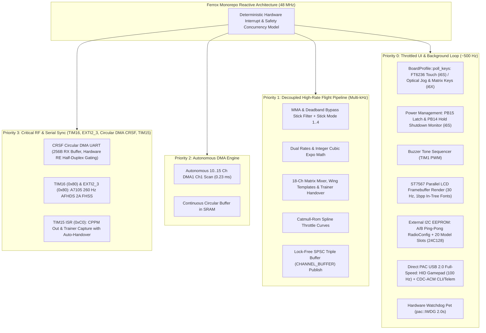

# ferrox

[](https://discord.gg/Gw4JS7skCq)
[](https://github.com/ferrox-rc/ferrox/releases)
[](https://github.com/ferrox-rc/ferrox/actions/workflows/ci.yml)
[](LICENSE)

**A universal, high-performance, bare-metal RC transmitter operating system written in `no_std` Rust.**

`ferrox` is a multi-radio firmware monorepo built around **`ferrox-core`**, a hardware-agnostic flight control, mixing, telemetry, and UI engine parameterized by compile-time [`BoardProfile`](crates/ferrox-core/src/board.rs) specialization. Originally forged on the **FlySky FS-i6X** and **FlySky FS-i6S**, `ferrox` is architected to bring deterministic, memory-safe Rust firmware to a growing lineup of RC transmitters across the open-source ecosystem:

| Transmitter Target | MCU Architecture | Status | Primary RF / Module Support | Display |
| :--- | :--- | :--- | :--- | :--- |
| **FlySky FS-i6X** (`boards/ferrox-i6x`) | STM32F072VB / APM32F072VB (Cortex-M0) | **Production** | Internal **AFHDS 2A** (`A7105`) + External **CRSF / ELRS** & **Spektrum DSM** | 128x64 Mono LCD |
| **FlySky FS-i6S** (`boards/ferrox-i6s`) | STM32F072VB / APM32F072VB (Cortex-M0) | **Production** | Internal **AFHDS 2A** (`A7105`) + External **CRSF / ELRS** & **Spektrum DSM** | Capacitive Touch 128x64 |
| **RadioMaster Pocket** (`boards/ferrox-pocket`) | STM32F407VET6 (Cortex-M4F) | **Hardware Bring-Up** | Internal **ExpressLRS (CRSF)** or **CC2500** + Nano Module Bay | 128x64 Mono LCD + Scroll Wheel |
| **Jumper T12 / T12 Pro** (`boards/ferrox-pocket`) | STM32F407VET6 (Cortex-M4F) | **Supported Target** | Internal Multi-Protocol / CC2500 + External Module Bay | 128x64 Mono LCD + Scroll Wheel |
| **FrSky Taranis X9D / X9D+** (`boards/ferrox-pocket`) | STM32F407VET6 (Cortex-M4F) | **Supported Target** | Internal FrSky ACCST/ACCESS + External JR Module Bay | 212x64 Wide Mono LCD |
| **FrSky Taranis X9E** (`boards/ferrox-pocket`) | STM32F407VET6 (Cortex-M4F) | **Supported Target** | Internal FrSky ACCST/ACCESS + External JR Module Bay | 212x64 Wide Mono LCD (Tray) |
| **RadioLink AT9S Pro / AT10II** (`boards/ferrox-pocket`) | STM32F405 / STM32F407 (Cortex-M4F) | **Supported Target** | Multi-Protocol + External CRSF / ELRS Bay | 320x240 Color TFT (4-bit Indexed) |
| **RadioMaster GX12** (`boards/ferrox-pocket`) | STM32F407xG (Cortex-M4F) | **Supported Target** | Internal **ExpressLRS Gemini (CRSF)** + External JR Bay | 128x64 Mono OLED + Scroll Wheel |

Supports modular RF protocols (**AFHDS 2A**, **CRSF / ExpressLRS** with native on-radio device configurator, **CC2500**, and **Spektrum DSM2 / DSMX** with optional Forward Programming), zero-dependency direct PAC **USB 2.0 Full-Speed** stack (HID Joystick & CDC-ACM Serial CLI/telemetry), **FT6236 Capacitive Touchscreen** & **Electronic Power Management** (i6S), **Matrix Keypad** (i6X), **Rotary Scroll Wheel** (Pocket, T12, X9D, AT9S Pro), **MicroSD SPI Storage & Flight Telemetry Logging** (Pocket), **Trainer Subsystem** (CPPM Out/In & Spektrum Satellite wireless trainer), **Responsive 128x64 and 212x64 Wide Displays**, and a zero-heap **320x240 4-bit Indexed RGB565 Color Canvas**.

---

## 1. Monorepo Architecture & Multi-Radio Philosophy

The `ferrox` workspace unifies development, host-side testing, and binary releases into a single Cargo workspace designed to scale cleanly across diverse transmitter hardware:

- **Target-Agnostic Core (`crates/ferrox-core`):** Houses 100% of the shared flight pipeline, 32-line 18-channel matrix mixer, Catmull-Rom spline curves, Global Variables (`GV1..GV5`), acoustic variometer, external I2C EEPROM persistence engine, pre-flight safety interlocks, calibration wizard, modular RF protocol engines, 128×64 display widgets, and direct PAC USB stack.
- **Board Crates (`boards/ferrox-i6s`, `boards/ferrox-i6x`, `boards/ferrox-<target>`):** Thin board crates providing target-specific startup, pin mappings, and peripheral initialization.
- **Declarative `BoardProfile` Trait:** Hardware capabilities (supported RF protocols `SUPPORTED_PROTOCOLS`, default protocol `DEFAULT_PROTOCOL`, top-level and setup menu catalogs `MAIN_MENU_ITEMS`, `RADIO_SETUP_ITEMS`, `HARDWARE_EXT_ITEMS`, ADC channel counts, touch/jog-wheel navigation, and EEPROM CRC polynomials) are declared per board at compile time with zero runtime overhead and zero dynamic dispatch.
- **Rapid Porting to New Radios:** Bringing Ferrox to a new transmitter only requires defining a `BoardProfile` implementation and low-level GPIO/ADC/UART hooks in a new `boards/ferrox-<target>` crate. Menus, protocol setup screens, calibration wizards, and mixer bounds automatically adapt to the board's declared capabilities.
- **Direct PAC USB Driver:** Zero third-party USB crates. Implements USB 2.0 Full-Speed directly against the hardware Packet Memory Area (PMA), saving ~4 KB Flash and eliminating all heap/generic overhead.
- **Circular DMA CRSF UART:** 256-byte circular RX DMA with hardware half-duplex receiver gating (`RE` pin gating), eliminating UART self-echo without software skip counters.
- **External I2C EEPROM Storage:** Wear-leveled A/B ping-pong storage for `RadioConfig` and 20 dedicated `ModelConfig` slots stored on external 16 KB I2C EEPROM (24C128), completely isolating user model data from firmware flashing and preserving flash endurance.
- **Deterministic Concurrency:** Priority-driven interrupt scheduling paired with lock-free atomic `TripleBuffer` channel passing, protected critical sections during RF strobes and trainer reads, and a 2.0s hardware independent watchdog with sub-2ms warm reset recovery.
- **Lightweight Footprint:**
  - **FS-i6S (Cortex-M0)**: **~104.1 KB Flash** out of 128 KB (~23.9 KB free headroom) and **~6.3 KB static RAM** out of 16 KB.
  - **FS-i6X (Cortex-M0)**: **~99.8 KB Flash** out of 128 KB (~28.2 KB free headroom) and **~6.2 KB static RAM** out of 16 KB.
  - **RM Pocket (Cortex-M4F)**: **~89.8 KB Flash** out of 512 KB (~422 KB free headroom) and **~5.7 KB static RAM** out of 192 KB.
  - **Jumper T12 (Cortex-M4F)**: **~90.1 KB Flash** out of 512 KB and **~5.7 KB static RAM**.
  - **FrSky X9D / X9E (Cortex-M4F)**: **~90.5 KB Flash** out of 512 KB and **~5.7 KB static RAM** (1696 B 212x64 framebuffer).
  - **RadioLink AT9S Pro (Cortex-M4F)**: **~91.8 KB Flash** out of 512 KB and **~5.7 KB static RAM** + 38.4 KB CCM RAM (320x240 4bpp color canvas).

---

## 2. Target Hardware Map

### A. FlySky Targets (STM32F072 / APM32F072 - Cortex-M0 @ 48 MHz)

| Peripheral | Controller / Spec | FS-i6S Pins & Ports | FS-i6X Pins & Ports | Notes |
| :--- | :--- | :--- | :--- | :--- |
| **MCU** | STM32F072VB / APM32F072VB (48 MHz) | ARMv6-M (`thumbv6m-none-eabi`) | ARMv6-M (`thumbv6m-none-eabi`) | 128 KB Flash, 16 KB SRAM |
| **Power Control** | Power Switch & Latch | Electronic Latch `PB15` (Out), `PB14` (In) | Mechanical slide switch | i6S features soft hold-to-shutdown (`PB14` >= 1.5s) & blue LEDs (`PD10`/`PD11`) |
| **Primary Controls**| Touch / Keypad / Jog Wheel | **FT6236** Capacitive Touch (`PB8`/`PB9` I2C1) + `PA9`/`PA10` | 4x4 Matrix Keypad + Optical Jog Wheel (`PB8`/`PB9`) | i6S uses gesture navigation & virtual trims; i6X uses jog wheel & tactile keys |
| **DFU Bootloader** | Factory ROM DFU Bootloader | Hold `PA9` + `PA10` at power-on | Hold horizontal trims inward at power-on | Both: `System Info -> [OK] Reboot DFU` or USB CDC CLI command `dfu` |
| **RF Transceiver** | Amiccom **A7105** 2.4 GHz | **SPI1** (`PE12` CSN, `PE13..15`) | **SPI1** (`PE12` CSN, `PE13..15`) | AFHDS 2A 260 Hz FHSS; auto deep-sleep (`0x0F`) in CRSF mode |
| **External Module**| CRSF / ExpressLRS Bay | `USART1` (`PB6` TX / `PB7` RX), `PF6` Pwr | `USART2` (`PD5` TX / `PA15` RX) | Circular DMA UART with hardware `RE` half-duplex gating; baud rates up to 1.875M |
| **Non-Volatile Storage**| External I2C EEPROM (24C128) | **I2C2** (`PB10` SCL / `PB11` SDA) | **I2C2** (`PB10` SCL / `PB11` SDA) | 16 KB external EEPROM: A/B ping-pong `RadioConfig` + 20 dedicated `ModelConfig` slots |
| **Display** | **ST7567** (128x64 Monochrome LCD) | 8-bit Parallel (`PE0..7`, `PB3..5`, `PD2/7`)| 8-bit Parallel (`PE0..7`, `PB3..5`, `PD2/7`)| 1024-byte framebuffer in RAM; 30 Hz refresh; Electronic Volume contrast |
| **Backlight** | Factory LED / PWM Dimming | `PF3` On/Off / `PC9` `TIM3_CH4` PWM | `PF3` On/Off / `PC9` `TIM3_CH4` PWM | Backlight brightness 0..100% in Settings |
| **Analog Inputs** | 12-bit ADC1 via DMA | 11 stock (or 15 with `Ext ADC`) | 10 stock (or 14 with `Ext ADC`) | Continuous DMA1 circular scanner; mapped dynamically via Stick Mode 1..4 |
| **Trainer Port** | Hardware `TIM15` CPPM In/Out | `PF10` (CPPM Out) / `PF9` (Trainer In) | `PF10` (CPPM Out) / `PF9` (Trainer In) | 22.5 ms 8-CH CPPM output; 0.5 us input capture with auto instructor takeover |
| **USB Controller** | Native USB 2.0 Full-Speed (12 Mbps)| `PA11` (D-) / `PA12` (D+) | `PA11` (D-) / `PA12` (D+) | Direct PAC driver: HID Joystick (100 Hz), CDC-ACM Serial CLI, Composite, Off |
| **Audio** | Piezo Buzzer | `TIM1_CH1` (`PA8`) | `TIM1_CH1` (`PA8`) | Hardware PWM frequency & non-blocking tone sequencer (`Rich` & `Simple` profiles) |

### B. High-Speed Targets (STM32F407 / STM32F405 - Cortex-M4F @ 168 MHz)

| Transmitter Target | Display Specs | Storage Subsystem | RF Connectivity | Primary Input Devices |
| :--- | :--- | :--- | :--- | :--- |
| **RadioMaster Pocket** | ST7567 128x64 Mono LCD | Hybrid: I2C1 EEPROM + SPI2 microSD (`PB12..15`) + In-RAM | Internal ELRS (CRSF UART) / CC2500 + Nano Module Bay | Gimbals, Rotary Scroll Wheel, Push Button, 4 Aux Switches |
| **Jumper T12 / T12 Pro** | ST7567 128x64 Mono LCD | I2C1 EEPROM + SPI SD Card | Internal Multi-Protocol / CC2500 + JR Module Bay | Gimbals, Rotary Scroll Wheel, 6 Switches, 2 Detented Pots |
| **FrSky Taranis X9D / X9D+** | Wide 212x64 Mono LCD | I2C1 EEPROM + SPI SD Card | Internal ACCST/ACCESS + External JR Module Bay | Gimbals, 8 Switches (SA..SH), 2 Pots (S1/S2), 2 Sliders (LS/RS) |
| **FrSky Taranis X9E** | Wide 212x64 Mono LCD | I2C1 EEPROM + SPI SD Card | Internal ACCST/ACCESS + External JR Module Bay | Tray Gimbals, Expanded Switch Matrix, Rotary Pots & Sliders |
| **RadioLink AT9S Pro** | 320x240 Color TFT (4bpp Indexed) | I2C1 EEPROM + SPI Storage | Multi-Protocol + External CRSF/ELRS Module Bay | Gimbals, Rotary Scroll Wheel, 8 Switches, 2 Pots, 2 Sliders |
| **RadioMaster GX12** | 128x64 Mono OLED | Hybrid: I2C1 EEPROM + SPI2 microSD + In-RAM | Internal ExpressLRS Gemini (CRSF) + External JR Module Bay | Gimbals, Optical Scroll Wheel, 8 Switches (SA..SH), 2 Detented Pots (S1/S2) |

---

## 3. Software Architecture



### Monorepo Crate Hierarchy & Extensibility

```
ferrox/
├── crates/
│   ├── ferrox-core/            # Universal flight engine, mixer, math, UI, colors & BoardProfile
│   ├── ferrox-stm32f0/         # Shared STM32F0 hardware drivers (Buzzer, ST7567, I2C, Time, Watchdog)
│   └── ferrox-stm32f4/         # Shared STM32F4 HAL & QX7-family descriptors (Pocket, T12, X9D, X9E, AT9S Pro)
└── boards/
    ├── ferrox-i6s/             # FlySky FS-i6S target (capacitive touch, power latch, 11/15 ADC)
    ├── ferrox-i6x/             # FlySky FS-i6X target (matrix keypad, optical jog wheel, 10/14 ADC)
    └── ferrox-pocket/          # High-speed Cortex-M4F target (Pocket, T12, X9D, X9E, AT9S Pro)
```

- **`crates/ferrox-core`**: 100% portable, target-agnostic firmware engine containing the 18-channel 32-line matrix mixer, Catmull-Rom spline curves, external I2C EEPROM storage abstraction, pre-flight safety checks, dual-target unit tests, direct PAC USB driver, CRSF/ELRS configurator, responsive display engine (128x64 & 212x64), and zero-heap 4-bit indexed color canvas.
- **`crates/ferrox-stm32f0`**: Reusable hardware driver implementation of `ToneOutput`, `DisplayBus`, and `StorageBus` traits for the STM32F0/APM32F0 series.
- **`crates/ferrox-stm32f4`**: Reusable hardware drivers for STM32F407/F405 targets, featuring bare-metal SPI2 microSD driver (`sdcard.rs`), ST7567 display flush with page-stride math, and hybrid EEPROM/SD storage fallback.
- **`boards/ferrox-i6s` & `boards/ferrox-i6x`**: Zero-overhead Cortex-M0 target crates providing reset vectors, pin configurations, hardware drivers, and `BoardProfile` implementations.
- **`boards/ferrox-pocket`**: High-performance Cortex-M4F target crate providing automated memory map selection (direct DFU at `0x08000000` vs EdgeTX SD bootloader at `0x08008000`) and feature-gated compilation for RadioMaster Pocket, Jumper T12, FrSky X9D, FrSky X9E, and RadioLink AT9S Pro.
- **Extending to Other Radios**: To bring Ferrox to a new radio, simply implement the `BoardProfile` const trait. The new target immediately inherits the complete flight pipeline, mixer, telemetry, USB simulator, and configurator with zero duplicate code.

---

## 4. AFHDS 2A, CRSF, & Trainer Subsystems

### Internal RF: AFHDS 2A & 18-Channel i-BUS
- **Frequency Hopping (FHSS):** Hops across 16 deterministic channels every 3.850 ms (259.74 Hz) seeded from the 96-bit silicon UID (`0x1FFFF7AC`).
- **18-Channel Encoding:** Packs channels 1..14 into the base 16-bit slots and interleaves channels 15..18 into the upper bits matching Betaflight/INAV `rx/ibus.c`.
- **Per-Model Receiver Settings:** Configurable RF transmit power (`100mW`, `10mW`, `1mW`, `100uW`), PWM servo refresh rate (`50..400 Hz`), output format (`PWM`/`PPM`), and serial protocol (`i-BUS`/`S.BUS`).

### External RF: CRSF / ExpressLRS (`USART1` on `J15`)
- **Multi-Speed Serial:** Supports `115.2k (Low)`, `416.6k (TBS)`, `420k (ELRS)` (default), `921.6k (Fast)`, and `1.875M (Max)` in both 2-wire Full-Duplex (`PB6` TX + `PB7` RX) and 1-wire Half-Duplex (`PB6` `HDSEL` with self-echo suppression).
- **A7105 Auto Deep-Sleep:** Automatically places the internal A7105 transceiver into deep sleep (`0x0F`) when CRSF mode is active.
- **Native On-Radio Configurator:** Zero-heap TBS-Agent style configurator supporting 16-device discovery, Parameter 0 root-folder fast loading, 6-level nested folders, selection/integer modal editing, and command execution.

### Trainer Port: Hardware `TIM15` CPPM Out & In (`PF10` / `PF9`)
- **PPM Output (`PF10` / `TIM15_CH2`):** Deterministic 22.5 ms 8-channel CPPM stream (300 µs negative sync pulse) for external multi-protocol modules and flight simulator dongles. Automatically paused during USB Joystick simulator mode.
- **Trainer Input (`PF9` / `TIM15_CH1`):** 0.5 µs resolution hardware input capture for wired buddy-box student radios and FPV head-trackers. Activated when `Trainer In` is enabled and switch `SD` is Down, with automatic instructor stick-override takeover (`> 5%` stick deflection) and 50 ms signal-loss failsafe recovery.

---

## 5. Display & User Interface (128×64)

The ST7567 parallel LCD driver maintains a **1024-byte framebuffer** in SRAM (`128 * 64 / 8`) rendered via in-tree 1bpp glyph bitmap tables (`FONT_4X6_DATA` and `FONT_6X10_DATA` in [`crates/ferrox-core/src/display/fonts.rs`](crates/ferrox-core/src/display/fonts.rs)).
- **Throttled Refresh Rate (30 Hz):** Decouples graphical drawing from the multi-kHz flight control loop.
- **Multi-Page Flight Dashboard:** 5 switchable screens cycled by swiping UP/DOWN or tapping `[UP]`/`[DOWN]`:
  1. **Page 1/5 (Gimbals, Switches & Pots):** Live stick sliders (adapted to Stick Mode 1..4), trim ticks, adaptive non-overlapping switch/pot bar (`SA..SH`, `SWI..SWL`, and `VRA..VRF` pots), and live flight timer.
  2. **Page 2/5 (Primary Channels 1..10):** Real-time graphic bars and microsecond pulse readouts (`988..2012 µs`).
  3. **Page 3/5 (Auxiliary Channels 11..18):** Real-time graphic bars and microsecond readouts for channels 11..18.
  4. **Page 4/5 (Model Dashboard / CRSF Link Status):** Model name, 12x12 model icon, RxID, curve summary, and live link stats.
  5. **Page 5/5 (Configurable 4-Tile Telemetry Dashboard):** 2×2 quadrant layout (`Top-L`, `Top-R`, `Btm-L`, `Btm-R`) configurable in `Radio Setup -> Telem Page` across 13 telemetry sensors (`RX BAT`, `LQ/RSSI`, `TX BAT`, `CURRENT`, `CAP mAh`, `TX PWR`, `SNR`, `PKT RATE`, `ANTENNA`, `PKTS TX`, `PKTS RX`, `TIMER`, `OFF`).

---

## 6. Project Documentation

Comprehensive technical documentation is maintained in the [`docs/`](docs/) directory:

- **[User Guide & Operations Manual](docs/USER_GUIDE.md)**: Complete operator guide covering touch/button controls, 5-page flight dashboard, all 12 settings submenus, flight timers, trainer port, calibration, and DFU flashing.
- **[System Architecture & Timing Model](docs/ARCHITECTURE.md)**: Unified `ferrox` core + `crates/ferrox-stm32f0` HAL design, 48 MHz clock tree, real-time concurrency model, watchdog recovery, and memory footprint.
- **[Implementation Roadmap & Phase Status](docs/ROADMAP.md)**: Phased development history from board bring-up through codebase unification.
- **[AFHDS 2A Protocol & A7105 RF Driver](docs/RF_PROTOCOL.md)**: SPI1 hardware driver, 16-channel FHSS hopping table, 18-channel interleaved i-BUS packet structure, Model Match, and receiver binding.
- **[Flight Inputs & Digital Trims](docs/INPUT_SUBSYSTEM.md)**: 11/15-channel ADC DMA scanner, universal `AdcInputMode` decoding, MMA jitter filtering, touch/modifier digital trims, and TIM1 PWM buzzer driver.
- **[Flight Control & 18-Channel Mixing](docs/MIXER.md)**: 4-stage pipeline, integer cubic expo, Elevon/V-Tail/Flaperon templates, auxiliary channel mapping (`CH5..CH18`), and EdgeTX freeform matrix mixing.
- **[Stick Calibration & EEPROM Persistence](docs/CALIBRATION_AND_STORAGE.md)**: Adaptive 2-step calibration wizard, tolerance margins, 256-byte `RadioConfig` A/B ping-pong / 368-byte `ModelConfig` layout in external 16 KB I2C EEPROM.
- **[USB Subsystem & Simulator Manual](docs/USB_SUBSYSTEM.md)**: Hardware Full-Speed USB driver, 100 Hz HID Gamepad descriptor (8 axes, 16 buttons), CDC-ACM telemetry/CLI, and silent RF standby.
- **[CRSF / ExpressLRS Subsystem Guide](docs/CRSF_ELRS_GUIDE.md)**: Native CRSF/ELRS driver on `USART1` (`PB6`/`PB7` on `J15`), `PF6` (`H1`) power control, 5 baud rates up to 1.875M, and on-radio configurator.
- **[CRSF Protocol Specification & Verification](docs/CRSF_PROTOCOL_SPEC.md)**: Byte-level wire format, CRC8-DVB calculation, parameter discovery handshake, state machine lifecycle, and manual verification guide.
- **[Testing Methodology & Verification Guide](docs/TESTING.md)**: Dual-target host test harness (163/182 unit tests), peripheral mocking, deterministic virtual time, and adversarial state machine verification.
- **[Ecosystem Context & Background](docs/FIRMWARE_COMPARISON.md)**: Background on open-source FlySky firmware development, OpenI6X heritage, FS-i6S hardware evolution, and the unified `ferrox` Rust architecture.
- **[Hardware Reference & Pinout](docs/HARDWARE_REFERENCE.md)**: Detailed schematics, pin mappings, power latch, FT6236 touch protocol, ST7567 LCD timings, `J15`/`H1`/`J4`/`PC1..PC4` headers, and dual-MCU profiles.

---

## 7. Current Firmware Footprint

- **Application Flash ROM**:
  - **FS-i6X**: **~102.5 KB Flash** (`.text` ~89.1 KB + `.rodata` ~12.6 KB + `.data` 772B) out of 128 KB partition (**~25.5 KB / 19.9% free headroom**).
  - **FS-i6S**: **~106.3 KB Flash** (`.text` ~92.9 KB + `.rodata` ~12.6 KB + `.data` 764B) out of 128 KB partition (**~21.7 KB / 16.9% free headroom**).
- **Static RAM**: **~6.3 KB** (`.data` ~770B + `.bss` ~5.5 KB, which includes the 1024B LCD framebuffer, circular DMA queues, and triple buffers) out of **16 KB** available (**>9.7 KB guaranteed stack safety margin**).
- **Non-Volatile Storage**: **16,384 bytes** external I2C EEPROM (24C128) storing `RadioConfig` with A/B ping-pong wear leveling + 20 dedicated `ModelConfig` slots with board-specific CRC-16 (CCITT-False on i6S, ARC on i6X for 100% backward compatibility).
- **Automated Host Test Suite**: **182 passing unit tests** for i6S (`cargo test-host-i6s`) and **163 passing unit tests** for i6X (`cargo test-host-i6x`).

For the complete phase-by-phase feature checklist, see **[docs/ROADMAP.md](docs/ROADMAP.md)**.

---

## 8. Controls & Shortcuts

| Action | FS-i6S Control | FS-i6X Control | Notes |
| :--- | :--- | :--- | :--- |
| **Power On** | **Press & Hold Power Buttons** | **Slide Power Switch ON** | On i6S, blue LEDs illuminate and welcome chime sounds |
| **Power Off** | **Hold Power Button (>= 1.5s)** | **Slide Power Switch OFF** | On i6S, triggers animated shutdown modal & cuts `PB15` rail |
| **Cycle Flight Pages** | **Swipe UP / DOWN or Edge Tap** | **UP / DOWN Buttons** | Cycles Page 1 (Gimbals), 2 (CH 1..10), 3 (CH 11..18), 4 (Model), 5 (Telem) |
| **Open Settings Menu** | **Center Tap on Screen or Hold OK (`PA10`)** | **Hold OK Button** | Opens 13 submenus (Model, Mixer, Curves, Setup, Calib, Diag, etc.) |
| **Menu Navigation** | **Swipe / Tap Zones / Front Buttons** | **Jog Wheel / UP / DOWN / OK / CANCEL** | i6S uses gesture navigation; i6X uses optical jog wheel rotary scroll |
| **Digital Trims** | **Virtual Touch Borders or Buttons + Sticks** | **Physical 2-Way Trim Switches** | i6S supports stick-modifier trims & touch perimeter zones |
| **3-Axis Instant Trim** | **Rear Right (`PA10`) or Configured Switch** | **Configured Switch (e.g. `SWA..SWD`)** | Captures stick offsets into model trims (or resets to 0 at neutral) |
| **Enter DFU Bootloader (Cold)** | **Hold `PA9` + `PA10` during Power-On** | **Hold Roll Left + Yaw Right Inward** | Zero-disassembly cold-boot hardware combo into factory ROM DFU |
| **Enter DFU Bootloader (Soft)** | **`SYSTEM INFO -> [OK] Reboot DFU`** | **`SYSTEM INFO -> [OK] Reboot DFU`** | Clears screen, displays DFU splash, and jumps to ROM bootloader |
| **DFU via USB Serial** | **Send `dfu` in Serial CLI** | **Send `dfu` in Serial CLI** | Available when USB mode is set to CDC Serial or Composite |
| **Reset Flight Timer** | **Hold `[CANCEL]` (>= 1.0s) or Rear L** | **Hold `[CANCEL]` (>= 1.0s)** | Displays centered HUD progress bar on flight screen |
| **Direct Calibration (Boot)**| **Hold `OK` (`PA10`) during Power-On** | **Hold `OK` during Power-On** | Launches adaptive 2-step calibration wizard immediately on boot |

---

## 9. Flashing, Full Flash Backup, & Reversion

All supported transmitters feature on-board USB wired directly to the microcontroller or support SD card bootloaders. Flashing requires **zero disassembly**.

You can flash Ferrox using either of two methods:
- **Method A (EdgeTX Radios - SD Bootloader):** Flash directly from the radio menu without PC drivers or DFU tools.
- **Method B (Universal - Direct USB DFU):** Direct factory ROM flashing with raw 1:1 backup and restore.

---

### Method A: EdgeTX SD Bootloader (No Drivers Needed)

For RadioMaster Pocket, GX12, Boxer, Zorro, TX12, and Jumper T12 running the stock EdgeTX bootloader:

1. **Build or download** the bootloader-compatible `-sd.bin` binary (`cargo objcopy` builds and extracts `.bin` in one step):
   ```bash
   # RadioMaster Pocket:
   cargo objcopy -p ferrox-pocket --bin ferrox-pocket --release --target thumbv7em-none-eabihf --features "pocket,edgetx-bootloader" -- -O binary ferrox-pocket-sd.bin

   # Other EdgeTX STM32F4 targets (replace <board> with gx12, boxer, zorro, tx12, or t12):
   cargo objcopy -p ferrox-pocket --bin ferrox-pocket --release --target thumbv7em-none-eabihf --no-default-features --features "<board>,edgetx-bootloader" -- -O binary ferrox-<board>-sd.bin
   ```
2. Copy `ferrox-<board>-sd.bin` to the `/FIRMWARE/` folder on your microSD card.
3. Hold **both horizontal trims inward** while powering ON to enter the EdgeTX Bootloader.
4. Select **Write Firmware**, highlight `ferrox-<board>-sd.bin`, and confirm.
5. Ferrox boots immediately with your stock EdgeTX configuration untouched on the SD card!
6. **To revert:** Power down, hold trims inward to re-enter EdgeTX Bootloader, and select your stock EdgeTX `.bin`.

---

### Method B: Direct USB DFU (Silicon-Level Backup & Restore)

#### Step 1: Enter Factory ROM DFU Mode

- **RadioMaster Pocket / Jumper / FrSky (STM32F4):**
  1. Power the radio **OFF** and remove the microSD card.
  2. Plug a USB-C data cable into the **top USB port** (data/simulator port, not battery charging).
  3. The screen and LEDs will remain dark; the MCU boots directly into ST System ROM DFU mode (`0483:df11`).
- **FlySky FS-i6X (STM32F072 / APM32F072):**
  1. Power the radio **OFF**.
  2. Push both horizontal trims inward towards the power switch (**Roll Left + Yaw Right**), then slide the power switch ON.
- **FlySky FS-i6S (STM32F072 / APM32F072):**
  1. Power the radio **OFF**.
  2. Press and hold both front/rear tactile push-buttons (**`PA9` + `PA10`**), then press the power buttons.

> Verify DFU connection: Run `dfu-util -l`. You should see `Found DFU: [0483:df11]` (or `[314b:0106]` for APM32).

#### Step 2: Backup Stock Flash (DO NOT SKIP)

Pull your complete internal on-chip Flash memory directly to a local backup file:
```bash
# RadioMaster Pocket / Jumper T12 / FrSky X9D / X9E (512 KB Flash):
dfu-util -a 0 -s 0x08000000:524288 -U stock_backup_pocket.bin

# FlySky FS-i6X & FS-i6S (128 KB Flash):
dfu-util -a 0 -s 0x08000000:131072 -U stock_backup_flysky.bin

# FlySky with APM32 clone chip:
dfu-util -a 0 -d 314b:0106 -s 0x08000000:131072 -U stock_backup_flysky.bin
```

#### Step 3: Build & Extract `.bin` Firmware

`cargo build-*` compiles an ELF executable, while `dfu-util` and the EdgeTX SD bootloader require a raw `.bin` image. Install `cargo-binutils` and `llvm-tools-preview` once to enable single-step build + `.bin` extraction via `cargo objcopy`:
```bash
rustup target add thumbv6m-none-eabi thumbv7em-none-eabihf
rustup component add llvm-tools-preview
cargo install cargo-binutils
```

Build and convert your target binary to `.bin`:
```bash
# FlySky Targets:
cargo objcopy -p ferrox-i6s --bin ferrox-i6s --release --target thumbv6m-none-eabi -- -O binary ferrox-i6s.bin
cargo objcopy -p ferrox-i6x --bin ferrox-i6x --release --target thumbv6m-none-eabi -- -O binary ferrox-i6x.bin

# RadioMaster Pocket (direct DFU vs EdgeTX SD bootloader):
cargo objcopy -p ferrox-pocket --bin ferrox-pocket --release --target thumbv7em-none-eabihf -- -O binary ferrox-pocket.bin
cargo objcopy -p ferrox-pocket --bin ferrox-pocket --release --target thumbv7em-none-eabihf --features "pocket,edgetx-bootloader" -- -O binary ferrox-pocket-sd.bin

# Other Cortex-M4F Targets (replace <board> with gx12, boxer, zorro, tx12, qx7, tprov2, t12, x9d, x9e, or at9spro):
cargo objcopy -p ferrox-pocket --bin ferrox-pocket --release --target thumbv7em-none-eabihf --no-default-features --features <board> -- -O binary ferrox-<board>.bin
```

*(Workspace aliases `cargo build-i6s`, `cargo build-i6x`, `cargo build-pocket`, `cargo build-gx12`, `cargo build-t12`, `cargo build-x9d`, `cargo build-x9e`, and `cargo build-at9spro` are also available for quick ELF compilation or SWD flashing via `probe-rs`.)*

Flash the extracted `.bin` file via USB DFU:
```bash
# Flash RadioMaster Pocket:
dfu-util -a 0 -s 0x08000000:leave -D ferrox-pocket.bin

# Flash RadioMaster GX12:
dfu-util -a 0 -s 0x08000000:leave -D ferrox-gx12.bin

# Flash FlySky FS-i6X:
dfu-util -a 0 -s 0x08000000:leave -D ferrox-i6x.bin

# Flash FlySky FS-i6S:
dfu-util -a 0 -s 0x08000000:leave -D ferrox-i6s.bin

# Flash Jumper T12:
dfu-util -a 0 -s 0x08000000:leave -D ferrox-t12.bin

# Flash FrSky Taranis X9D:
dfu-util -a 0 -s 0x08000000:leave -D ferrox-x9d.bin
```

> [!TIP]
> **DFU Error State (`DFU state(10) = dfuERROR`)?**
> If `dfu-util` reports `Device's firmware is corrupt. It cannot return to run-time operations`, run `dfu-util -a 0 -e` to send a `DFU_CLRSTATUS` reset. Always include `:leave` on `-s 0x08000000:leave` so the bootloader exits cleanly.

#### Step 4: Revert to Stock Anytime

Because the hardware DFU bootloader is stored in permanent, read-only system ROM by STMicroelectronics, all radios are **100% unbrickable**. Restore your full flash backup at any time:
```bash
# Restore RadioMaster Pocket / Jumper / FrSky:
dfu-util -a 0 -s 0x08000000:leave -D stock_backup_pocket.bin

# Restore FlySky FS-i6X / FS-i6S:
dfu-util -a 0 -s 0x08000000:leave -D stock_backup_flysky.bin
```

---

## 10. Development Methodology & Automated Testing

This project was built through a **human-directed, AI-assisted development workflow** with physical hardware bench testing and automated host verification.

### Automated Testing Harness
To guarantee mathematical correctness and protocol compliance across all target boards without requiring physical hardware:
- **Host Unit Test Execution**:
  ```bash
  # Test key board targets:
  cargo test -p ferrox-core --lib --features board-i6x --target x86_64-unknown-linux-gnu -- --test-threads=1
  cargo test -p ferrox-core --lib --features board-pocket --target x86_64-unknown-linux-gnu -- --test-threads=1
  cargo test -p ferrox-core --lib --features board-gx12 --target x86_64-unknown-linux-gnu -- --test-threads=1
  cargo test -p ferrox-core --lib --features board-t12 --target x86_64-unknown-linux-gnu -- --test-threads=1
  cargo test -p ferrox-core --lib --features board-x9d --target x86_64-unknown-linux-gnu -- --test-threads=1
  cargo test -p ferrox-core --lib --features board-x9e --target x86_64-unknown-linux-gnu -- --test-threads=1
  cargo test -p ferrox-core --lib --features board-at9spro --target x86_64-unknown-linux-gnu -- --test-threads=1
  ```
- **Target Cross-Compilation Verification**:
  ```bash
  cargo build-i6s
  cargo build-i6x
  cargo build-pocket
  cargo build-pocket-sd
  cargo build-gx12
  cargo build-t12
  cargo build-x9d
  cargo build-x9e
  cargo build-at9spro
  ```
- **Peripheral & Timing Decoupling**: Peripheral drivers use `#[cfg(test)]` mocks to simulate serial UART FIFO queues, touch coordinates, and advance virtual time deterministically.
- **Physical Hardware Validation**: Every subsystem (DMA ADC scanning, FT6236 capacitive touch, electronic power latch, optical jog wheel, rotary scroll wheels, A7105 SPI/RF state machine, ST7567 LCD, zero-dependency direct PAC USB HID/CDC, circular DMA CRSF/ELRS engine, TIM15 PPM In/Out, SPI2 SD card block storage, and external EEPROM) has been validated on hardware.

---

## 11. Acknowledgments & Prior Art

This project stands on the shoulders of the open-source RC community and owes special gratitude to:

- **Kuba (qba667), Janek (ajjjjjjjj), and the OpenI6X Team**: For their groundbreaking reverse-engineering of the FlySky FS-i6X/i6S hardware, bus timings, ST7567 LCD initialization sequence, A7105 SPI registers, bootloader jump sequences, and the `PC9` backlight PWM dimming mod.
- **Wimalopaan**: For extensive real-hardware testing on both FS-i6X and FS-i6S, logic analyzer protocol traces, multi-pot/switch hardware expansion verification, and deep feedback on TBS-Agent UI paradigms and over-the-air CRSF parameter synchronization.
- **Suds**: For testing collaboration, feedback, and hardware bring-up support on the RadioMaster GX12.
- **OpenTX and EdgeTX Teams**: For defining modern open-source RC transmitter mixing, telemetry architectures, and simulator standards.
- **ExpressLRS & Team BlackSheep**: For pioneering open, high-performance CRSF protocols and parameter synchronization.

---

## 12. License & Disclaimer of Liability

This project is open-source software provided under the **GNU General Public License v3.0 (GPL-3.0)**.

### Disclaimer of Warranty
THE SOFTWARE IS PROVIDED "AS IS", WITHOUT WARRANTY OF ANY KIND, EXPRESS OR IMPLIED, INCLUDING BUT NOT LIMITED TO THE WARRANTIES OF MERCHANTABILITY, FITNESS FOR A PARTICULAR PURPOSE, TITLE, AND NONINFRINGEMENT. IN NO EVENT SHALL THE AUTHORS, MAINTAINERS, OR COPYRIGHT HOLDERS BE LIABLE FOR ANY CLAIM, DAMAGES, OR OTHER LIABILITY, WHETHER IN AN ACTION OF CONTRACT, TORT, OR OTHERWISE, ARISING FROM, OUT OF, OR IN CONNECTION WITH THE SOFTWARE OR THE USE OR OTHER DEALINGS IN THE SOFTWARE.

### Operational Safety Warning
Operating radio-controlled aircraft, multirotors, and vehicles involves inherent risks of personal injury, property damage, and loss of life. Flashing custom or experimental firmware is done entirely at your own risk.

Pilots are solely responsible for:
1. Conducting comprehensive ground bench tests and fail-safe verification (e.g., motor shutoff on radio power loss) prior to flight.
2. Performing physical range checks in accordance with local model aviation safety guidelines.
3. Complying with all local radio frequency regulations, transmission power limits, and model aviation safety codes.
