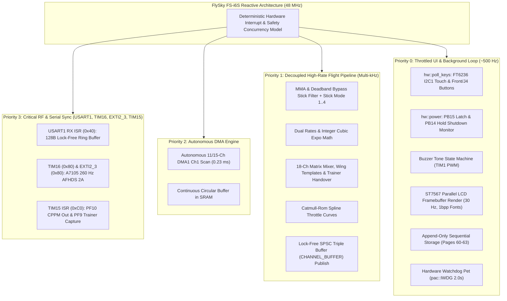

# ferrox

A minimalist, high-performance, clean-slate RC transmitter firmware monorepo written in `no_std` Rust.

Targeting both the **FlySky FS-i6S** and **FlySky FS-i6X**, powered by the unified **`ferrox-core`** flight-control engine with zero-cost compile-time `BoardProfile` const trait specialization.

Supports the built-in **A7105** 2.4 GHz RF transceiver (**AFHDS 2A** protocol), external **CRSF / ExpressLRS** modules, zero-dependency direct PAC **USB 2.0 Full-Speed** driver (HID Joystick & CDC-ACM Serial CLI/telemetry), **FT6236 Capacitive Touchscreen** (i6S), **Electronic Power Management** (i6S), **Optical Jog Wheel** (i6X), **TIM15 Trainer Subsystem (PPM Out & In)**, and **128×64 Monochrome LCD** interface.

---

## 1. Monorepo Architecture & Philosophy

The `ferrox` workspace unifies the development, testing, and release process for both major FlySky transmitters into a single monorepo while retaining 100% board-specific optimizations:

- **Unified `ferrox-core` (`crates/ferrox-core`):** Contains the shared flight pipeline, 18-channel matrix mixer, Catmull-Rom spline curves, EEPROM storage, pre-flight safety interlocks, calibration wizard, AFHDS 2A & CRSF engines, and direct PAC USB stack.
- **Board Crates (`boards/ferrox-i6s` & `boards/ferrox-i6x`):** Thin board entrypoints implementing target-specific startup, vector tables, pin mappings, and memory layouts.
- **`BoardProfile` Const Trait:** Hardware parameters (touch presence, power latch, ADC channel counts, SWD buttons, jog wheel, EEPROM CRC polynomials, and default modes) are evaluated at compile time with zero runtime overhead and zero dynamic dispatch.
- **Direct PAC USB Driver:** Zero third-party USB crates. Implements USB 2.0 Full-Speed directly against the STM32F072 dedicated 1 KB Packet Memory Area (PMA), saving ~4 KB Flash and eliminating all heap/generic overhead.
- **Circular DMA CRSF UART:** 256-byte circular RX DMA with hardware half-duplex receiver gating (`RE` pin gating), eliminating UART self-echo without software skip counters.
- **Deterministic Concurrency:** Priority-driven interrupt scheduling paired with lock-free atomic `TripleBuffer` channel passing, protected critical sections during RF strobes and trainer reads, and a 2.0s hardware independent watchdog with sub-2ms warm reset recovery.
- **Lightweight Footprint:**
  - **FS-i6S**: **~105.1 KB Flash** out of 128 KB (~25.9 KB free headroom, 80.2% flash used) and **~6.3 KB static RAM** out of 16 KB.
  - **FS-i6X**: **~100.8 KB Flash** out of 128 KB (~30.2 KB free headroom, 76.9% flash used) and **~6.2 KB static RAM** out of 16 KB.

---

## 2. Target Hardware Map (STM32F072VB / APM32F072VB)

| Peripheral | Controller / Spec | MCU Pins & Ports | Notes |
| :--- | :--- | :--- | :--- |
| **MCU** | STM32F072VB / APM32F072VB (Cortex-M0 @ 48 MHz) | ARMv6-M (`thumbv6m-none-eabi`) | 128 KB Flash (full 128 KB for application), 16 KB SRAM |
| **Power Latch** | Electronic Power Switch | `PB15` (Output) | Driven HIGH immediately on boot in `hw::power::init()`; held HIGH across DFU jump |
| **Power Button**| Soft Power Shutdown Sense | `PB14` (Input, Active Low) | Monitored by `PowerManager`; hold >= 1.5s triggers safe Flash flush & shutdown |
| **Power LEDs** | Dual Blue Button LEDs | `PD10`, `PD11` (Outputs) | Solid ON in flight mode; 2 Hz blink when Settings Menu is open |
| **Touchscreen** | **FocalTech FT6236** Capacitive | **I2C1** + GPIOs | 400 kHz Fast Mode, 7-byte packet reader, 90° coordinate swap to 128x64 |
| | I2C SCL / SDA | `PB8` (SCL) / `PB9` (SDA) | Hardware I2C1 (AF1) |
| | Hardware Reset (RST) | `PA15` (Active Low) | 5 ms hardware reset pulse on initialization |
| | Touch Interrupt (INT) | `PC12` (Active Low) | Signals available touch packets; polled at single-cycle speed |
| **Front Buttons** | Dual Tactile Switches (Power assembly) | `PA9` (Left) / `PA10` (Right) | Active LOW with pull-ups; configurable as `SWE`/`SWF`, `TIMER RESET`, `INSTANT TRIM`, or `TRIMS MOD` |
| **DFU Bootloader**| STM32 ROM DFU Bootloader | `0x1FFF_C800` | Cold combo: hold `PA9` + `PA10` at power-on; soft DFU via `SYSTEM INFO` or USB CLI `dfu` (`0x2000_3FF0`) |
| **Watchdog** | Hardware Independent Watchdog | `pac::IWDG` (40 kHz LSI) | 2.0s hard timeout, `DBGMCU_APB1_FZ` halt freeze, sub-2ms in-flight warm recovery (`RCC_CSR`) |
| **RF Transceiver** | Amiccom **A7105** 2.4 GHz | **SPI1** + GPIOs | SPI1 (`PE13` SCK, `PE14` MISO, `PE15` MOSI); auto deep-sleep (`0x0F`) in CRSF mode |
| | Chip Select (CSN) | `PE12` (Active Low) | Fast GPIO output |
| | PA / LNA / Antenna Switch | `PE8` (RX), `PE9` (TX), `PE10`/`PE11` | Diversity TR switch; configurable output power (`100mW`, `10mW`, `1mW`, `100uW`) |
| | Packet Ready IRQ | `PB2` (EXTI2) | GIO2 line from A7105 (Tx/Rx done) |
| | RF Timer | `TIM16` | Periodic packet scheduling (3.850 ms / 259.74 Hz) |
| **Display** | **ST7567** (128×64 Monochrome LCD) | 8-bit 6800 Parallel Bus | 1024-byte framebuffer in RAM; 30 Hz refresh (~33 ms); Electronic Volume (EV) contrast (20..50) |
| | Data Bus (D0..D7) | `PE0 .. PE7` | Full-byte ODR write (`GPIOE->ODR[7:0]`) |
| | Control Lines | `PB3` (RS), `PB4` (RST), `PB5` (RW), `PD2` (CS), `PD7` (E) | 6800-series parallel bus |
| | Backlight | `PF3` / `PC9` | Active HIGH (`PF3`) / Hardware PWM (`PC9` `TIM3_CH4`) |
| **Analog Inputs** | 12-bit ADC1 via DMA | 11 or 15 Channels scanned | Continuous circular DMA1 Ch1 buffer (`0x07FF` stock, `0x7FFF` with `Ext ADC (PC)`) |
| | Sticks (RH, RV, LV, LH) | `PA0`, `PA1`, `PA2`, `PA3` | Channels 0..3 (mapped dynamically via Stick Mode 1..4) |
| | Potentiometers (VRA, VRB)| `PA6`, `PA7` | Channels 6 (VR1 / Left), 7 (VR2 / Right) |
| | Switches (SA, SB, SC, SD)| `PA4`, `PA5`, `PB0`, `PB1` | Channels 4 (2-pos), 5 (3-pos), 8 (3-pos), 9 (2-pos); configurable via `AdcInputMode` |
| | Battery Sense | `PC0` | Channel 10 (10 kΩ / 5.1 kΩ divider: `(raw * 977064) / 409500` mV) |
| | Extended Analog (`Ext ADC`)| `PC1`, `PC2`, `PC3`, `PC4` | Channels 11..14 (`ADC_IN11..14`): `VRC..VRF` pots or `SWI..SWL` switches |
| **CRSF / Serial** | External Module Bay (`J15` & `H1`) | `USART1` (`PB6` TX / `PB7` RX) | 115.2k, 416.6k, 420k, 921.6k, 1.875M baud; full (2W) & half-duplex (1W); `PF6` (`H1`) power control |
| **Trainer Port** | Hardware `TIM15` CPPM In/Out | `PF10` (`TIM15_CH2` Out) / `PF9` (`TIM15_CH1` In) | 22.5 ms 8-CH CPPM output on `PF10`; 0.5 µs input capture on `PF9` with `SD` Down handover |
| **SWD / Buttons** | Header `J4` | `PA13` (SWDIO / `SG`), `PA14` (SWCLK / `SH`) | Switchable in `Radio Setup -> J4 Mode` between ARM SWD Debug and `SG`/`SH` buttons |
| **USB Controller** | Native USB Full-Speed (12 Mbps)| `PA11` (D-) / `PA12` (D+) | Joystick HID (100 Hz), CDC-ACM Serial (CLI + JSON stream), Composite, Off |
| **Audio** | Piezo Buzzer | `TIM1_CH1` (`PA8`) | Hardware PWM frequency & non-blocking tone sequencer (`Rich` & `Simple` profiles) |

---

## 3. Software Architecture



### Unified `ferrox` Crate & Hardware Abstraction (`src/hw/`)
The firmware is structured as a unified library crate (`ferrox` in [`src/lib.rs`](src/lib.rs)) paired with a thin board-specific hardware layer in [`src/hw/`](src/hw/):
- **Shared Core (`src/*`)**: 100% identical across `flysky-i6s-rs` and `flysky-i6x-rs` (`main.rs`, `lib.rs`, `chip/`, `display/`, `rf/`, `crsf/`, `trainer/`, `usb/`, `ui/`, `input.rs`, `mixer.rs`, `storage.rs`, `safety.rs`, `calib.rs`, `curve.rs`, `trim.rs`, `buzzer.rs`, `watchdog.rs`, `time.rs`).
- **FS-i6S Hardware Layer (`src/hw/`)**:
  - [`src/hw/mod.rs`](src/hw/mod.rs): Board constants, battery scaling, setup menu hooks, dashboard switch/pot rendering, and `BoardIdleState`.
  - [`src/hw/power.rs`](src/hw/power.rs): `PB15` electronic power latch, `PB14` hold-to-shutdown manager, and `PD10`/`PD11` blue LEDs.
  - [`src/hw/touch/`](src/hw/touch/mod.rs): FocalTech FT6236 I2C1 driver (`ft6236.rs`) and touch gesture / virtual trim / stick modifier navigator (`nav.rs`).
  - [`src/hw/adc.rs`](src/hw/adc.rs): 11/15-channel ADC1 + DMA1 circular scanner (`PA0..PA7`, `PB0..PB1`, `PC0`, and `PC1..PC4`).
  - [`src/hw/keys.rs`](src/hw/keys.rs): Front tactile buttons (`PA9`/`PA10`), J4 SWD buttons (`PA13`/`PA14`), and DFU entry checks.
  - [`src/hw/uart.rs`](src/hw/uart.rs): `USART1` (`PB6`/`PB7` on `J15`) CRSF driver and `PF6` (`H1`) external module power control.

---

## 4. AFHDS 2A, CRSF, & Trainer Subsystems

### Internal RF: AFHDS 2A & 18-Channel i-BUS
- **Frequency Hopping (FHSS):** Hops across 16 deterministic channels every 3.850 ms (259.74 Hz) seeded from the 96-bit silicon UID (`0x1FFFF7AC`).
- **18-Channel Encoding:** Packs channels 1..14 into the base 16-bit slots and interleaves channels 15..18 into the upper bits matching Betaflight/INAV `rx/ibus.c`.
- **Per-Model Receiver Settings:** Configurable RF transmit power (`100mW`, `10mW`, `1mW`, `100uW`), PWM servo refresh rate (`50..400 Hz`), output format (`PWM`/`PPM`), and serial protocol (`i-BUS`/`S.BUS`).

### External RF: CRSF / ExpressLRS (`USART1` on `J15`)
- **Multi-Speed Serial:** Supports `115.2k (Low)`, `416.6k (TBS)`, `420k (ELRS)` (default), `921.6k (Fast)`, and `1.875M (Max)` in both 2-wire Full-Duplex (`PB6` TX + `PB7` RX) and 1-wire Half-Duplex (`PB6` `HDSEL` with self-echo suppression).
- **A7105 Auto Deep-Sleep:** Automatically places the internal A7105 transceiver into deep sleep (`0x0F`) when CRSF mode is active.
- **Native On-Radio Configurator:** Zero-heap TBS-Agent style configurator supporting 16-device discovery, Parameter 0 root-folder fast loading, 6-level nested folders, selection/integer modal editing, and command execution.

### Trainer Port: Hardware `TIM15` CPPM Out & In (`PF10` / `PF9`)
- **PPM Output (`PF10` / `TIM15_CH2`):** Deterministic 22.5 ms 8-channel CPPM stream (300 µs negative sync pulse) for external multi-protocol modules and flight simulator dongles. Automatically paused during USB Joystick simulator mode.
- **Trainer Input (`PF9` / `TIM15_CH1`):** 0.5 µs resolution hardware input capture for wired buddy-box student radios and FPV head-trackers. Activated when `Trainer In` is enabled and switch `SD` is Down, with automatic instructor stick-override takeover (`> 5%` stick deflection) and 50 ms signal-loss failsafe recovery.

---

## 5. Display & User Interface (128×64)

The ST7567 parallel LCD driver maintains a **1024-byte framebuffer** in SRAM (`128 * 64 / 8`) rendered via in-tree 1bpp glyph bitmap tables (`FONT_4X6_DATA` and `FONT_6X10_DATA` in [`src/display/fonts.rs`](src/display/fonts.rs)).
- **Throttled Refresh Rate (30 Hz):** Decouples graphical drawing from the multi-kHz flight control loop.
- **Multi-Page Flight Dashboard:** 5 switchable screens cycled by swiping UP/DOWN or tapping `[UP]`/`[DOWN]`:
  1. **Page 1/5 (Gimbals, Switches & Pots):** Live stick sliders (adapted to Stick Mode 1..4), trim ticks, adaptive non-overlapping switch/pot bar (`SA..SH`, `SWI..SWL`, and `VRA..VRF` pots), and live flight timer.
  2. **Page 2/5 (Primary Channels 1..10):** Real-time graphic bars and microsecond pulse readouts (`988..2012 µs`).
  3. **Page 3/5 (Auxiliary Channels 11..18):** Real-time graphic bars and microsecond readouts for channels 11..18.
  4. **Page 4/5 (Model Dashboard / CRSF Link Status):** Model name, 12x12 model icon, RxID, curve summary, and live link stats.
  5. **Page 5/5 (Configurable 4-Tile Telemetry Dashboard):** 2×2 quadrant layout (`Top-L`, `Top-R`, `Btm-L`, `Btm-R`) configurable in `Radio Setup -> Telem Page` across 13 telemetry sensors (`RX BAT`, `LQ/RSSI`, `TX BAT`, `CURRENT`, `CAP mAh`, `TX PWR`, `SNR`, `PKT RATE`, `ANTENNA`, `PKTS TX`, `PKTS RX`, `TIMER`, `OFF`).

---

## 6. Project Documentation

Comprehensive technical documentation is maintained in the [`docs/`](docs/) directory:

- **[User Guide & Operations Manual](docs/USER_GUIDE.md)**: Complete operator guide covering touch/button controls, 5-page flight dashboard, all 13 settings submenus, flight timers, trainer port, calibration, and DFU flashing.
- **[System Architecture & Timing Model](docs/ARCHITECTURE.md)**: Unified `ferrox` core + `src/hw/` HAL design, 48 MHz clock tree, real-time concurrency model, watchdog recovery, and memory footprint.
- **[Implementation Roadmap & Phase Status](docs/ROADMAP.md)**: Phased development history from board bring-up through codebase unification.
- **[AFHDS 2A Protocol & A7105 RF Driver](docs/RF_PROTOCOL.md)**: SPI1 hardware driver, 16-channel FHSS hopping table, 18-channel interleaved i-BUS packet structure, Model Match, and receiver binding.
- **[Flight Inputs & Digital Trims](docs/INPUT_SUBSYSTEM.md)**: 11/15-channel ADC DMA scanner, universal `AdcInputMode` decoding, MMA jitter filtering, touch/modifier digital trims, and TIM1 PWM buzzer driver.
- **[Flight Control & 18-Channel Mixing](docs/MIXER.md)**: 4-stage pipeline, integer cubic expo, Elevon/V-Tail/Flaperon templates, auxiliary channel mapping (`CH5..CH18`), and EdgeTX freeform matrix mixing.
- **[Stick Calibration & EEPROM Persistence](docs/CALIBRATION_AND_STORAGE.md)**: Adaptive 2-step calibration wizard, tolerance margins, 256-byte `RadioConfig` A/B ping-pong / 384-byte `ModelConfig` layout in external 16 KB I2C EEPROM.
- **[USB Subsystem & Simulator Manual](docs/USB_SUBSYSTEM.md)**: Hardware Full-Speed USB driver, 100 Hz HID Gamepad descriptor (8 axes, 16 buttons), CDC-ACM telemetry/CLI, and silent RF standby.
- **[CRSF / ExpressLRS Subsystem Guide](docs/CRSF_ELRS_GUIDE.md)**: Native CRSF/ELRS driver on `USART1` (`PB6`/`PB7` on `J15`), `PF6` (`H1`) power control, 5 baud rates up to 1.875M, and on-radio configurator.
- **[CRSF Protocol Specification & Verification](docs/CRSF_PROTOCOL_SPEC.md)**: Byte-level wire format, CRC8-DVB calculation, parameter discovery handshake, state machine lifecycle, and manual verification guide.
- **[Testing Methodology & Verification Guide](docs/TESTING.md)**: Dual-target host test harness (`151` unit tests), peripheral mocking, deterministic virtual time, and adversarial state machine verification.
- **[Ecosystem Context & Background](docs/FIRMWARE_COMPARISON.md)**: Background on open-source FlySky firmware development, OpenI6X heritage, FS-i6S hardware evolution, and the unified `ferrox` Rust architecture.
- **[Hardware Reference & Pinout](docs/HARDWARE_REFERENCE.md)**: Detailed schematics, pin mappings, power latch, FT6236 touch protocol, ST7567 LCD timings, `J15`/`H1`/`J4`/`PC1..PC4` headers, and dual-MCU profiles.

---

## 7. Current Firmware Footprint

- **Application Flash ROM**: **~110.0 KB** (`.text` 92,288B + `.rodata` 11,700B + `.data` 5,876B = 109,864 bytes) used out of **128 KB** partition (**~18.1 KB / 14.1% free headroom**).
- **Static RAM**: **~6.9 KB** (`.data` 5,876B + `.bss` 1,060B = 6,936 bytes) out of **16 KB** available (**>56% SRAM free** with **>9.0 KB** guaranteed stack safety margin).
- **Non-Volatile Storage**: **16,384 bytes** external I2C EEPROM (on I2C2 `PB10`/`PB11`) storing `RadioConfig` (A/B ping-pong) + 20 dedicated `ModelConfig` slots.
- **Automated Host Test Suite**: **151 passing unit tests** (`cargo test`).

For the complete phase-by-phase feature checklist, see **[docs/ROADMAP.md](docs/ROADMAP.md)**.

---

## 8. Controls & Shortcuts

| Action | Control | Notes |
| :--- | :--- | :--- |
| **Power On** | **Power Buttons** | Press & hold power buttons until blue LEDs illuminate and welcome screen appears |
| **Power Off** | **Hold Power Button (>= 1.5s)**| Displays animated shutdown modal; safely flushes Flash and cuts power rail via `PB15` |
| **Cycle Flight Pages** | **Swipe UP / DOWN or Edge Tap** | Cycles through Page 1/5 (Gimbals), Page 2/5 (CH 1..10), Page 3/5 (CH 11..18), Page 4/5 (Model), Page 5/5 (Custom Telem) |
| **Open Settings Menu** | **Center Tap on Screen or Hold OK (`PA10`)** | Opens 13 submenus: Model Select, Model Setup, D/R & Expo, Thr Curve, Wing/Mixer, Aux Channels, Ch Reverse, Radio Setup, Protocol Setup, Monitors, Calib, Diag, & Info |
| **Menu Navigation** | **Swipe / Tap Zones / Front Buttons** | Top = Up, Bottom = Down, Left = Cancel, Right = OK; Left Rear (`PA9`) = Cancel, Right Rear (`PA10`) = OK |
| **Digital Trims: Stick Modifier** | **Rear Buttons + Gimbal Deflection** | When `Rear L` / `Rear R` set to `TRIMS MOD`: Hold `PA9` + Left Stick or `PA10` + Right Stick |
| **Digital Trims: Virtual Touch** | **Perimeter Tap Targets** | Left border = Throttle trim, Right border = Pitch trim, Bottom border = Yaw/Roll trims |
| **3-Axis Instant Trim** | **Rear Right (`PA10`) or `INST-TRIM` Switch** | Captures current Aileron, Elevator, and Rudder stick offsets into model trims (or resets to 0 at neutral) |
| **Enter DFU Bootloader (Cold Boot)**| **Hold Rear Buttons (`PA9` + `PA10`)** | Zero-disassembly cold-boot combo at power-on to jump directly into factory ROM DFU |
| **Enter DFU Bootloader (Software)** | **`SYSTEM INFO` Menu or USB CLI** | `System Info -> [OK] Reboot DFU` or USB serial command `dfu` / `reboot bootloader` |
| **Reset Flight Timer** | **Hold `[CANCEL]` (>= 1.0s) or Rear L** | Displays centered HUD progress bar on flight screen (or instant click when `Rear L` = `TIMER RESET`) |
| **Direct Calibration (Boot)**| **Hold `OK` (`PA10`) during Power-On** | Launches adaptive 2-step calibration wizard immediately on boot |

---

## 9. Flashing, Full Flash Backup, & Reversion

The stock FlySky FS-i6S features an on-board Micro-USB port wired directly to the STM32F072 microcontroller. Flashing requires **zero disassembly**:

### Step 1: Enter Factory ROM DFU Mode

You can enter DFU mode using any of three convenient methods:

#### A. Zero-Disassembly Cold-Boot Combo (Recommended)
1. Ensure the transmitter is powered **OFF**.
2. Press and hold both rear/front tactile push-buttons simultaneously (**Left Button `PA9` + Right Button `PA10`**).
3. While holding both buttons, press the power buttons to turn the unit on. `PB15` latches power ON, and the MCU jumps straight into the permanent STM32 factory ROM DFU bootloader (`0483:df11` for STM32, `314b:0106` for APM32).

#### B. Software Menu Trigger
From the running firmware, navigate to **`Settings -> 13. System Info`**, and tap/press **`[OK]`** (`[OK] Reboot DFU`). The firmware writes `0xDEADBEEF` to SRAM `0x2000_3FF0`, maintains power on `PB15`, and warm-reboots directly into ROM DFU.

#### C. USB Serial CLI Command
When connected via USB CDC serial (`SERIAL` or `COMPOSITE` mode), simply send `dfu` or `reboot bootloader` in the terminal.

### Step 2: Backup Entire Flash Memory (Recommended Before First Flash)
Before flashing custom firmware, pull your complete 128 KB on-chip Flash memory (including stock firmware, factory calibration, and existing model data) directly to a file:
```bash
# Pull complete 128 KB on-chip Flash to a local backup file:
dfu-util -a 0 -s 0x08000000:131072 -U stock_backup.bin
```

### Step 3: Build & Flash ferrox

Build release binaries for your specific target hardware:
```bash
# Build for FlySky FS-i6S:
cargo build --release --target thumbv6m-none-eabi -p ferrox-i6s
arm-none-eabi-objcopy -O binary target/thumbv6m-none-eabi/release/ferrox-i6s ferrox-i6s.bin

# Build for FlySky FS-i6X:
cargo build --release --target thumbv6m-none-eabi -p ferrox-i6x
arm-none-eabi-objcopy -O binary target/thumbv6m-none-eabi/release/ferrox-i6x ferrox-i6x.bin
```

Flash the compiled binary via USB DFU:
```bash
# Flash FS-i6S (STM32F072):
dfu-util -a 0 -s 0x08000000:leave -D ferrox-i6s.bin

# Flash FS-i6S (APM32F072):
dfu-util -a 0 -d 314b:0106 -s 0x08000000:leave -D ferrox-i6s.bin

# Flash FS-i6X (STM32F072):
dfu-util -a 0 -s 0x08000000:leave -D ferrox-i6x.bin
```

> [!TIP]
> **DFU Error State (`DFU state(10) = dfuERROR`)?**
> If `dfu-util` reports `Device's firmware is corrupt. It cannot return to run-time operations`, run `dfu-util -a 0 -e` to send a `DFU_CLRSTATUS` reset. Always include `:leave` on `-s 0x08000000:leave` so the bootloader exits cleanly.

### Step 4: Revert to Stock Anytime
Because the hardware DFU bootloader is stored in permanent, read-only system ROM by STMicroelectronics, the transmitter is **unbrickable**. You can restore your full flash backup at any time:
```bash
dfu-util -a 0 -s 0x08000000:leave -D stock_backup.bin
```

---

## 10. Development Methodology & Automated Testing

This project was built through a **human-directed, AI-assisted development workflow** with physical hardware bench testing and automated host verification.

### Automated Testing Harness
To guarantee mathematical correctness and protocol compliance across both target boards without requiring physical hardware:
- **Host Unit Test Execution**:
  ```bash
  # Test with FS-i6S hardware profile (178 unit tests):
  cargo test -p ferrox-core --features board-i6s --lib --target x86_64-unknown-linux-gnu -- --test-threads=1

  # Test with FS-i6X hardware profile (159 unit tests):
  cargo test -p ferrox-core --features board-i6x --lib --target x86_64-unknown-linux-gnu -- --test-threads=1
  ```
- **Peripheral & Timing Decoupling**: Peripheral drivers in `crates/ferrox-core/src/hw/` use `#[cfg(test)]` mocks to simulate serial UART FIFO queues, touch coordinates, and advance virtual time deterministically.
- **Physical Hardware Validation**: Every subsystem (DMA ADC scanning, FT6236 capacitive touchscreen, electronic power latch, optical jog wheel, A7105 SPI/RF state machine, ST7567 LCD, zero-dependency direct PAC USB HID/CDC, circular DMA CRSF/ELRS engine, TIM15 PPM In/Out, and external EEPROM) has been verified on physical hardware.

---

## 11. Acknowledgments & Prior Art

This project stands on the shoulders of the open-source RC community and owes special gratitude to:

- **Kuba (qba667), Janek (ajjjjjjjj), and the OpenI6X Team**: For their groundbreaking reverse-engineering of the FlySky FS-i6X/i6S hardware, bus timings, ST7567 LCD initialization sequence, A7105 SPI registers, bootloader jump sequences, and the `PC9` backlight PWM dimming mod.
- **Wimalopaan**: For extensive real-hardware testing on both FS-i6X and FS-i6S, logic analyzer protocol traces, multi-pot/switch hardware expansion verification, and deep feedback on TBS-Agent UI paradigms and over-the-air CRSF parameter synchronization.
- **OpenTX and EdgeTX Teams**: For defining modern open-source RC transmitter mixing, telemetry architectures, and simulator standards.
- **ExpressLRS & Team BlackSheep**: For pioneering open, high-performance CRSF protocols and parameter synchronization.

---

## 12. License & Disclaimer of Liability

This project is open-source software provided under the **GNU General Public License v3.0 (GPL-3.0)**.

### Disclaimer of Warranty
THE SOFTWARE IS PROVIDED "AS IS", WITHOUT WARRANTY OF ANY KIND, EXPRESS OR IMPLIED, INCLUDING BUT NOT LIMITED TO THE WARRANTIES OF MERCHANTABILITY, FITNESS FOR A PARTICULAR PURPOSE, TITLE, AND NONINFRINGEMENT. IN NO EVENT SHALL THE AUTHORS, MAINTAINERS, OR COPYRIGHT HOLDERS BE LIABLE FOR ANY CLAIM, DAMAGES, OR OTHER LIABILITY, WHETHER IN AN ACTION OF CONTRACT, TORT, OR OTHERWISE, ARISING FROM, OUT OF, OR IN CONNECTION WITH THE SOFTWARE OR THE USE OR OTHER DEALINGS IN THE SOFTWARE.

### Operational Safety Warning
Operating radio-controlled aircraft, multirotors, and vehicles involves inherent risks of personal injury, property damage, and loss of life. Flashing custom or experimental firmware is done entirely at your own risk.

Pilots are solely responsible for:
1. Conducting comprehensive ground bench tests and fail-safe verification (e.g., motor shutoff on radio power loss) prior to flight.
2. Performing physical range checks in accordance with local model aviation safety guidelines.
3. Complying with all local radio frequency regulations, transmission power limits, and model aviation safety codes.
