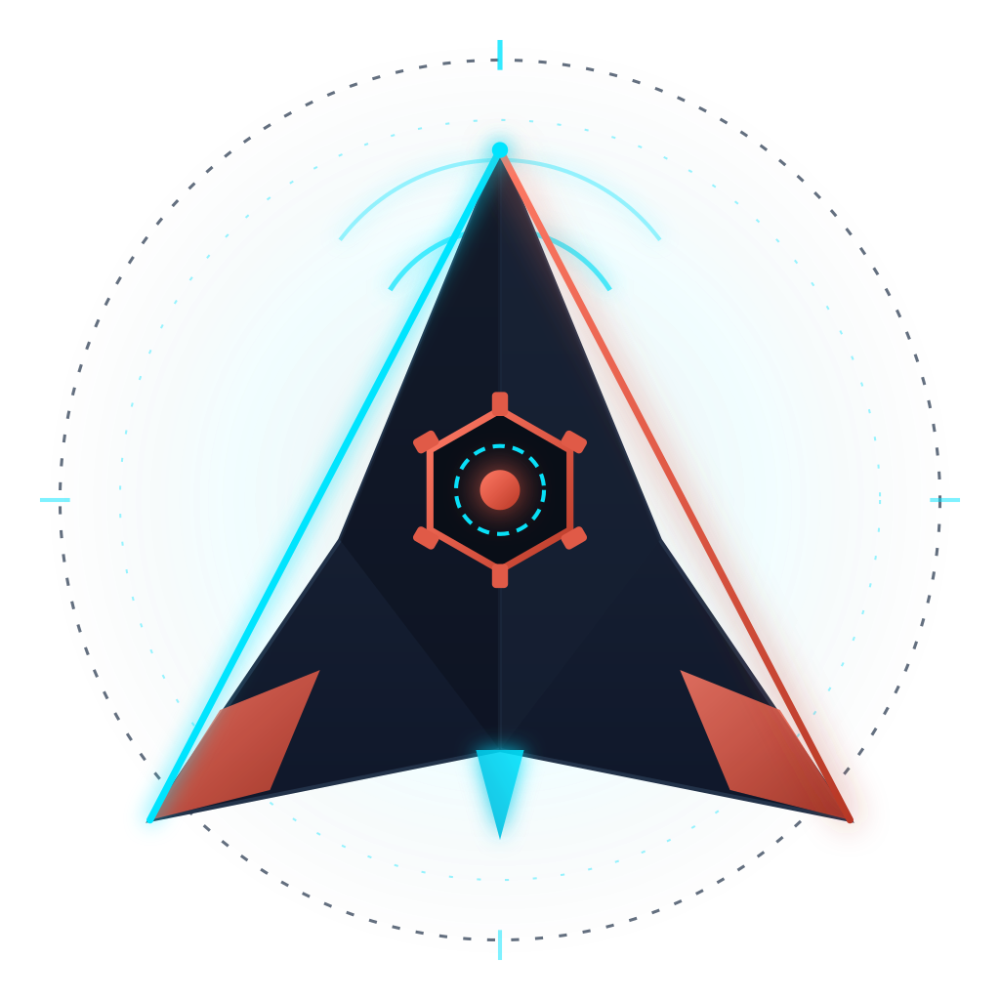

<p align="center">
  
</p>

<h1 align="center">ferrox</h1>

<p align="center">
  <a href="https://discord.gg/Gw4JS7skCq"></a>
  <a href="https://github.com/ferrox-rc/ferrox/releases"></a>
  <a href="https://github.com/ferrox-rc/ferrox/actions/workflows/ci.yml"></a>
  <a href="LICENSE"></a>
</p>

<p align="center">
  <strong>A universal, high-performance, bare-metal RC transmitter operating system written in <code>no_std</code> Rust.</strong>
</p>

Ferrox delivers memory-safe, deterministic, sub-millisecond latency firmware for open-source RC transmitters. Built from the ground up without dynamic memory allocation (`no_std`), Ferrox provides an intuitive UI, multi-protocol RF support, comprehensive flight mixing, and USB simulator support across both ultra-compact 128 KB Cortex-M0 and modern Cortex-M4F radios.

---

## ⚡ Quick Start Guide

### 1. Flash via Browser (Easiest & Recommended)
Use the **[Ferrox-RC Web Flasher](https://ferroxrc.com/flasher)** to flash firmware directly from Chrome, Edge, or Opera via WebUSB DFU — **no CLI tools or driver installation required**:
1. Put your transmitter into bootloader mode (see [DFU Combinations](#transmitter-shortcuts--dfu-bootloader)).
2. Connect the transmitter's top USB data port to your computer.
3. Open **[ferroxrc.com/flasher](https://ferroxrc.com/flasher)**, select your radio model, and click **Flash**.
4. **Optional — Custom Build:** Use the **Custom Build** tab to enable only the protocols and features you use (e.g. `CRSF`, `CC2500`, `MPM 4-in-1`, `DSM Forward Prog`, `Soaring`, `Voice Audio`) in ~2 minutes with no local compiler. *(Leave `edgetx-bootloader` unchecked for WebUSB DFU; check it to download an `-sd.bin` image for SD card flashing.)*

---

### 2. Alternative: EdgeTX SD Bootloader (No CLI Tools)
If your radio runs EdgeTX (RadioMaster Pocket, GX12, Boxer, Zorro, TX12, Jumper T12, FrSky X9E):
1. Download or build the `ferrox-<board>-sd.bin` firmware image for your radio from [Releases](https://github.com/ferrox-rc/ferrox/releases).
2. Copy `ferrox-<board>-sd.bin` into the `/FIRMWARE/` folder on your microSD card.
3. Hold **both horizontal trims inward** while powering ON to enter the EdgeTX Bootloader.
4. Select **Write Firmware**, select the binary, and confirm.
5. Revert anytime by flashing your previous EdgeTX `.bin` from the same menu.

---

### 3. First Power-On & Calibration
1. Power on your radio.
2. If prompted (or on first boot), enter the stick calibration wizard (**Hold `[OK]` at boot** or navigate to `Settings -> Calibration`).
3. Follow the on-screen prompts: center gimbals & pots, press OK, then move all sticks and rotary pots across their full travel limits.
4. Create or select a model slot in `Model Settings` and choose your RF protocol!

For detailed controls, settings menus, and operations, see the **[User Guide & Operations Manual](docs/USER_GUIDE.md)**.

---

## 📻 Supported Radios & Hardware Targets

Ferrox supports a growing ecosystem of transmitters via modular compile-time board profiles:

| Transmitter Target | Status | Architecture | Display | RF Protocol Support | Storage |
| :--- | :--- | :--- | :--- | :--- | :--- |
| **FlySky FS-i6X** | Field-Tested | STM32F072 (M0 @ 48 MHz) | 128×64 Mono LCD | Internal **AFHDS 2A** + External **CRSF/ELRS**, **CC2500**, **DSM** | 16 KB EEPROM |
| **FlySky FS-i6S** | Field-Tested | STM32F072 (M0 @ 48 MHz) | 128×64 Touch + Jog | Internal **AFHDS 2A** + External **CRSF/ELRS**, **CC2500**, **DSM** | 16 KB EEPROM |
| **RadioMaster Pocket** | Field-Tested | STM32F407 (M4F @ 168 MHz) | 128×64 Mono LCD + Roller | Internal **ELRS** / **CC2500** + External Nano Bay | EEPROM + MicroSD |
| **RadioMaster Zorro** | Field-Tested | STM32F407 (M4F @ 168 MHz) | 128×64 Mono LCD + Roller | Internal **ELRS** / **CC2500** / **4-in-1 MPM** + Nano Bay | EEPROM + MicroSD |
| **RadioMaster TX12 MKII** | Field-Tested | STM32F407 (M4F @ 168 MHz) | 128×64 Mono LCD + Roller | Internal **ELRS** / **CC2500** + External JR Bay | EEPROM + MicroSD |
| **RadioMaster GX12** | Field-Tested | STM32F407 (M4F @ 168 MHz) | 128×64 Mono OLED + Roller | Internal **ELRS Gemini** + External JR Bay | EEPROM + MicroSD |
| **RadioMaster Boxer** | Beta | STM32F407 (M4F @ 168 MHz) | 128×64 Mono LCD + Roller | Internal **ELRS** / **CC2500** / **4-in-1 MPM** + JR Bay | EEPROM + MicroSD |
| **Jumper T-Pro V2** | Beta | STM32F407 (M4F @ 168 MHz) | 128×64 Mono LCD + Roller | Internal **ELRS** / **CC2500** / **4-in-1 MPM** + Nano Bay | EEPROM + MicroSD |
| **Jumper T12 / T12 Pro** | Beta | STM32F407 (M4F @ 168 MHz) | 128×64 Mono LCD + Roller | Internal **CC2500 / MPM** + External JR Bay | EEPROM + MicroSD |
| **FrSky Taranis Q X7** | Beta | STM32F407 (M4F @ 168 MHz) | 128×64 Mono LCD + Roller | Internal FrSky + External JR Bay | EEPROM + MicroSD |
| **FrSky Taranis X9D / X9D+** | Beta | STM32F407 (M4F @ 168 MHz) | 212×64 Wide Mono LCD | Internal FrSky + External JR Bay | EEPROM + MicroSD |
| **FrSky Taranis X9E** | Beta | STM32F407 (M4F @ 168 MHz) | 212×64 Wide Mono LCD | Internal FrSky + External JR Bay | EEPROM + MicroSD |
| **RadioLink AT9S Pro / AT10II** | Beta | STM32F405/407 (M4F @ 168 MHz) | 320×240 Color TFT (4bpp) | Multi-Protocol + External CRSF/ELRS Bay | EEPROM + SPI Flash |

---

## ✨ Key Features

### 🎛️ Flight Control & Mixing Pipeline
- **18-Channel Freeform Matrix Mixer**: 32 mix lines supporting differential mixes, curves, trim inclusion, multiplex modes (Add, Multiply, Replace), and flight phases.
- **Aircraft Templates**: Quick presets for Elevon / Delta Wing, V-Tail, Flaperons, and twin-motor Differential Thrust (Bait Boat).
- **Precision Expo & Curves**: Integer cubic exponential curves and 5,7,9-point Catmull-Rom spline curves with smooth interpolation.
- **Flight Modes & Trims**: Stick Modes 1, 2, 3, and 4; 3-axis Instant Trim; digital cross-trims with audible center and limit chimes.
- **Pre-Flight Safety Interlocks**: Throttle warning, switch position checks, failsafe verification, and acoustic battery alarms before takeoff.
- **Soaring & F5J Contest Suite**: Motor run timer, competition window timer, altitude launch logging, and dedicated gliding mixes (crow/airbrakes, camber, reflex).
- **Logical Switches**: `L1..L8` programmable logic engines supporting threshold comparators, delta triggers, edge timers, SR flip-flops, and boolean gating.

### 📡 Modular RF Protocols (No Lua Required)
- **Dual-Module UART Routing (STM32F4)**: Select **Internal** (`USART1`) or **External (Bay)** (`USART6`) per model across `CRSF`, `CC2500`, `MPM 4-in-1`, and `DSM`.
- **Crossfire (CRSF) & ExpressLRS**: High-speed bidirectional telemetry up to 1.875M baud with circular DMA UART and built-in **on-radio CRSF/ELRS configurator** (queries module menus dynamically — no Lua scripts or version syncing required).
- **CC2500 (`rf-cc2500`)**: Dedicated single-chip CC2500 support for FrSky D8/D16 (FCC & LBT), Futaba S-FHSS, and Graupner HoTT with S.Port/HoTT telemetry, RX Num, Freq Tune, and Range Check.
- **4-in-1 Multi-Protocol Module (`rf-mpm`)**: Separate 4-in-1 MPM build feature for internal or external JR/Nano bay 4-in-1 modules.
- **Spektrum DSM2 / DSMX (`rf-dsm`, `dsm-fwd-prog`)**: Native DSM serial support with built-in **Spektrum Forward Programming** (pulls setup menus directly from stabilized receivers — no Lua required).
- **FlySky AFHDS 2A (`rf-afhds2a`)**: Native 260 Hz FHSS protocol on FlySky radios with 18-channel interleaved i-BUS telemetry.

### 🔊 Audio, Variometer & Telemetry Logging (STM32F4)
- **Voice Callouts**: Non-blocking WAV playback using standard EdgeTX `/SOUNDS/<lang>/` voice packs (battery, telemetry lost, flight timers, F5J cues).
- **Acoustic Variometer**: Configurable climb/sink deadbands, pulse/continuous/mute sink modes, motor-run mute, and switch assignment.
- **SD Card Telemetry Logging (`sd-logging`)**: Background CSV flight logging triggered on arming or switch.

### 🎮 USB Simulator & Connectivity
- **Zero-Dependency Direct PAC USB 2.0**: Native USB stack written directly to the STM32 PMA memory without external crate overhead.
- **Driverless USB HID Gamepad**: 100 Hz update rate, 8 analog axes, and 16 buttons — fully compatible with Liftoff, Velocidrone, RealFlight, AccuRC, and DCL.
- **CDC-ACM Serial CLI**: Live telemetry streaming, configuration dump/restore, and software-triggered DFU reboot.
- **Trainer System**: 8-channel CPPM Trainer Out and 0.5 µs hardware capture Trainer In with automatic instructor stick-override takeover.

### 🖥️ Display & Navigation
- **Responsive Multi-Page Dashboard**: Fast 30 Hz rendering with dedicated pages for live gimbals/switches, channels 1..10, auxiliary channels 11..18, model telemetry link, and configurable 4-tile sensor dashboards.
- **Multi-Display Architecture**: Optimized 1-bit monochrome rendering for 128×64 and 212×64 displays, plus a zero-heap 4-bit indexed 320×240 color canvas for color radios.
- **Intuitive Controls**: Native support for optical jog wheels and capacitive touchscreens (FS-i6S), 4x4 matrix keypads (FS-i6X), and rotary scroll wheels.

---

## 🎮 Transmitter Shortcuts & DFU Bootloader

| Action | FlySky FS-i6S | FlySky FS-i6X | RadioMaster & EdgeTX Radios (F4) |
| :--- | :--- | :--- | :--- |
| **Power ON** | Hold dual power buttons | Slide switch ON | Press/hold power button |
| **Power OFF** | Hold power button (>= 1.5s) | Slide switch OFF | Hold power button |
| **Cycle Flight Pages** | Swipe UP / DOWN or edge tap | Press UP / DOWN | Press PAGE / roller scroll |
| **Open Menu** | Center tap screen or hold `OK` | Hold `OK` button | Press `SYS` or hold roller |
| **Calibrate Gimbals** | Hold `OK` during power-on | Hold `OK` during power-on | `Radio Setup -> Calibration` |
| **EdgeTX Bootloader** | N/A | N/A | Hold horizontal trims inward at power-on |
| **ROM DFU Bootloader** | Hold `PA9` + `PA10` at power-on | Hold horizontal trims inward at power-on | Unplug battery, hold boot button / plug top USB |
| **Software DFU Jump** | `System Info -> [OK] Reboot DFU` | `System Info -> [OK] Reboot DFU` | `System Info -> [OK] Reboot DFU` or CLI `dfu` |

---

## 🛠️ Building from Source

Ferrox requires a standard Rust bare-metal toolchain:

```bash
# 1. Install bare-metal Rust targets
rustup target add thumbv6m-none-eabi thumbv7em-none-eabihf
rustup component add llvm-tools-preview
cargo install cargo-binutils

# 2. Clone the repository
git clone https://github.com/ferrox-rc/ferrox.git
cd ferrox

# 3. Build firmware for your target radio
cargo build-i6x          # FlySky FS-i6X
cargo build-i6s          # FlySky FS-i6S
cargo build-pocket       # RadioMaster Pocket (direct DFU @ 0x08000000)
cargo build-pocket-sd    # RadioMaster Pocket (EdgeTX SD Bootloader @ 0x08008000)
cargo build-gx12         # RadioMaster GX12
cargo build-t12          # Jumper T12 / T12 Pro
cargo build-x9d          # FrSky Taranis X9D
cargo build-x9e          # FrSky Taranis X9E
cargo build-at9spro      # RadioLink AT9S Pro
```

### Creating `.bin` Images for DFU or SD Card
To generate raw `.bin` files for flashing via `dfu-util` or SD card:
```bash
# FlySky Targets:
cargo objcopy -p ferrox-i6x --bin ferrox-i6x --release --target thumbv6m-none-eabi -- -O binary ferrox-i6x.bin
cargo objcopy -p ferrox-i6s --bin ferrox-i6s --release --target thumbv6m-none-eabi -- -O binary ferrox-i6s.bin

# EdgeTX SD Bootloader image (automated 32 KiB header padding):
./tools/build-sd-bin.sh pocket    # Linux / macOS
.\tools\build-sd-bin.bat pocket   # Windows
```

---

## 📚 Documentation Index

Comprehensive guides, hardware references, and protocol specifications are available in the [`docs/`](docs/) directory:

### User & Tester Guides
- 📖 **[User Guide & Operations Manual](docs/USER_GUIDE.md)**: Screen navigation, menu trees, flight timers, trainer port setup, and DFU flashing.
- 🧑‍✈️ **[Pilot & Hardware Tester Field Guide](docs/TESTER_FIELD_GUIDE.md)**: Flashing via EdgeTX bootloader, 5-minute sanity test checklist, and rollback procedures.

### Hardware & Peripherals
- 🔌 **[Hardware Reference & Pinouts](docs/HARDWARE_REFERENCE.md)**: Schematics, pin mappings, power latch, touch protocol, and bus timings.
- 🕹️ **[Flight Inputs & Digital Trims](docs/INPUT_SUBSYSTEM.md)**: ADC DMA scanning, stick filtering, and cross-trim implementations.
- 🧲 **[Hall Effect Gimbals Upgrade Guide](docs/HALL_GIMBALS.md)**: Wiring, calibration, and support for Hall sensor gimbals.
- 💾 **[Calibration & EEPROM Persistence](docs/CALIBRATION_AND_STORAGE.md)**: I2C EEPROM wear-leveling, model slots, and CRC validation.

### Protocols & Subsystems
- 📡 **[CRSF / ExpressLRS Subsystem Guide](docs/CRSF_ELRS_GUIDE.md)**: High-speed UART DMA, parameter synchronization, and on-radio configurator.
- 📶 **[AFHDS 2A Protocol Specification](docs/RF_PROTOCOL.md)**: A7105 SPI driver, FHSS frequency hopping, and 18-channel i-BUS packet format.
- 🎛️ **[Flight Control & 18-Channel Matrix Mixing](docs/MIXER.md)**: Freeform mixer pipelines, expo math, curves, and wing templates.
- 🎮 **[USB Subsystem & Simulator Manual](docs/USB_SUBSYSTEM.md)**: Direct PAC USB 2.0 driver, 100 Hz HID Gamepad descriptors, and CDC-ACM serial.

### Architecture & Verification
- 📐 **[System Architecture & Timing Model](docs/ARCHITECTURE.md)**: Hardware interrupt model, real-time concurrency, lock-free queues, and memory budgets.
- 🧪 **[Testing Methodology & Verification](docs/TESTING.md)**: Dual-target host test harness, peripheral mocking, and CI automated verification.

---

## ⚖️ License

Ferrox is open-source software licensed under the **[GNU General Public License v3.0 (GPL-3.0)](LICENSE)**.
Commercial use, modification, and redistribution are permitted under the terms of GPLv3.
